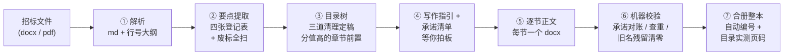
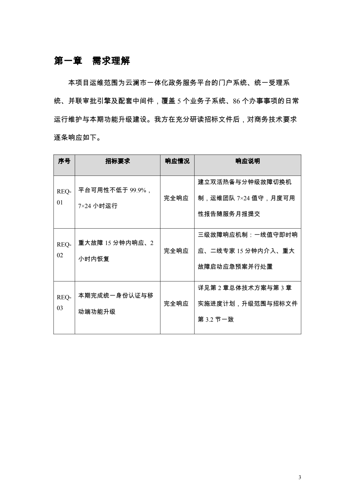
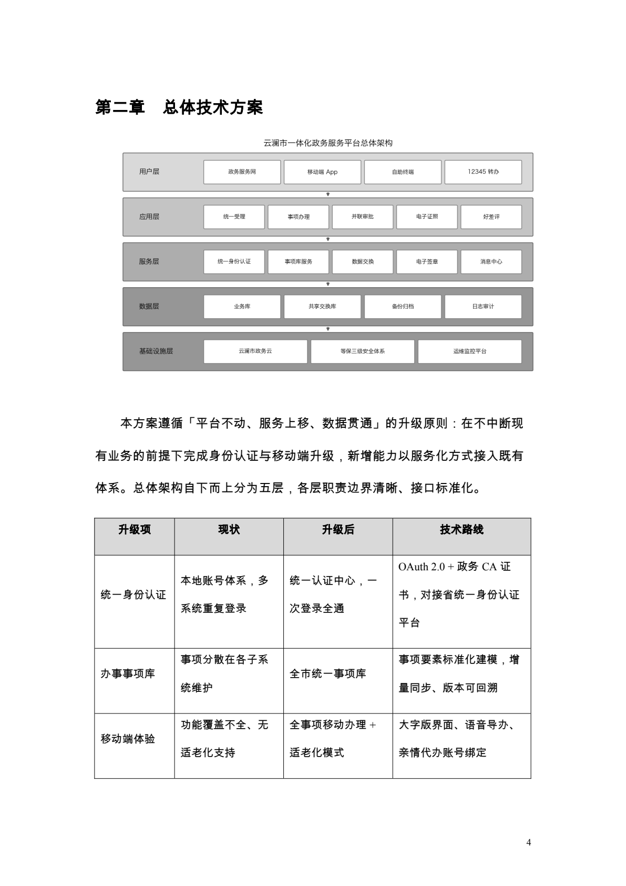
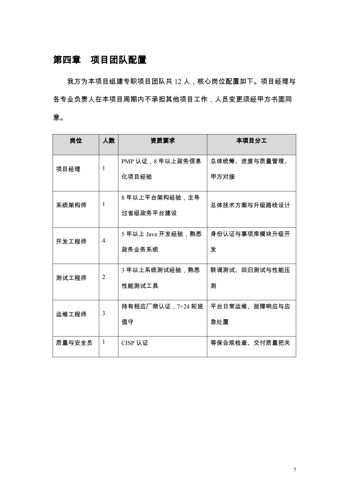

<div align="center">


# 灵燕标书写作套件 Full-Pipeline Bid Writing Suite

**一个专门编写投标文件（标书）的 AI Agent Skill。**
**已在多份真实标书的完整编写中实战使用——每个版本都由真实项目复盘打磨而来。**

[](LICENSE)
[](listing/CHANGELOG.md)


*An agent skill that turns a tender document into a submission-ready Word proposal —
parse → register → outline → write → validate → assemble.*

</div>

---

## 这是什么

**这不是「通用文档写作工具」，它只做一件事：把招标文件变成可以递交的标书 Word。**

把本技能装进 Claude Code / CodeBuddy / WorkBuddy 等支持 Agent Skill 的环境，丢给它一份
招标文件（docx / pdf），它会走完一条带质量闸门的流水线：解析 → 要点登记 → 目录规划 →
承诺拍板 → 逐节写作 → 机器校验 → 合册出书，最终交付每册一本**可直接递交的整本 docx**。

**实战背书**：本技能已在多份真实标书编写中从头跑到尾。[CHANGELOG](listing/CHANGELOG.md)
里 1.0 → 1.1.3 的每一次迭代都来自真实投标项目的复盘修复——真机首测修出的 5 个 P0、
真实项目节间查重误报从 24 条收敛到 1 条、按真实评分表对齐目录先后……方法论不是纸面推演，
是被评委和甲方阅读习惯反复校准过的。

## 写标书的三类事故，与对应防线

任何一类都可能直接废标，所以这套技能的每个环节都在防它们：

| 常见事故 | 本套件的防线 |
|---|---|
| **编数字**：AI 编造工期、人员、报价 | 承诺类数字只出自你逐条拍板的《关键事实与承诺》清单，机器校验逐条对账——承诺了没写进正文会被点名，改了承诺旧值残留会被检出 |
| **丢要求**：漏掉废标条款 / 评分点 | 要点登记四张表（必须章节 MAND / 招标模板 TPL / 商务技术要求 REQ / 评分维度 SCORE）+ 废标条款全扫，目录与正文的每节都挂来源编号，覆盖情况逐条可审计 |
| **改了乱**：手改合册后章节编号全错 | 整本是派生产物——改内容回节文件层改再重新合册，章节编号由树位置纯函数生成，永不手写 |

## 工作流程



每个环节的详细纪律在 [`tender-writing-suite/references/`](tender-writing-suite/references/)，
共 12 份方法论文档，Agent 按需读取。

## 产出长什么样

下面整本 docx 由本技能全流程自动产出（为演示使用虚构主体「云澜市 / 星灵创科」，
版式即真实交付版式——宋体小四正文、黑体标题族、表头跨页重复）：

| 封面（机械生成） | 目录（条目写实测页码） |
|:---:|:---:|
|  |  |
| **逐条响应表（来源可追溯）** | **甘特图（真图 PNG，非占位）** |
|  |  |
| **分层架构图（真图 PNG）** | **团队配置表** |
|  |  |

此外还有：表格引擎支持合并单元格（横跨/竖并）、相对列宽、宽表横向页、行不跨页拆断；
历史标书素材元素级保真拷贝；目录页码可导出「标题→页码」映射（评分索引表回填用）。
收尾会给出沉淀建议：成品标书与公司事实归入你的资料库/知识库后，下次自动成为
可检索素材——越用越快。

## 快速开始

**1. 安装依赖**（一次性）

```bash
pip install python-docx pypdfium2 docxcompose Pillow
```

**2. 装进你的 Agent 环境**

- **上架/分发形态（推荐）**：上传或导入 `out-zips/tender-writing-suite-<版本>.zip`
  ——单技能扁平包（`SKILL.md` + `references/` + `scripts/` + `templates/`，两级目录），
  一次装完即含全部四个环节；
- **开发形态**：把五个目录（`tender-writing-suite/`、`tender-analysis/`、
  `tender-writing/`、`tender-review/`、`tender-docx/`）平级放进技能目录——仅供调试
  单个环节，脚本按「扁平 → 平级 → `stages/`」三形态自动解析兄弟模块。

打包产物由 `listing/build_package.py` 装配（平台硬限制：Skill 只允许两级目录，
三级嵌套会被「目录层级超限」拒绝）。

（Claude Code / CodeBuddy / WorkBuddy 等支持 Agent Skill 规范的环境均可。）

**3. 说一句话开始**

```text
解读这份招标文件，提取要点并生成投标目录树
梳理废标条款和评分标准，帮我整理成登记表
按目录写第 3 章，写法参考我上传的历史标书
```

## 技能包结构

仓库里是**开发形态**：五个目录平级，入口装纪律与路由，环节装各自流程，脚本按引擎成组归位。
上架产物只有一个扁平包（见 `out-zips/tender-writing-suite-<版本>.zip`）：`SKILL.md` 在根，
四环节 `SKILL.md` 转成 `references/stage-*.md`，脚本与模板全部拍平进 `scripts/`、`templates/`。

```text
tender-writing-suite/          # 入口：红线 8 条 / 确认门 / 技能路由 / 工作目录约定
├── SKILL.md
└── references/                # 证据边界 / 阶段门 / 回复口径

tender-analysis/               # 第零步–第三步：解析 / 要点 / 废标 / 目录
├── SKILL.md
├── references/                # analysis-lite / transcribe-scans / outline 三件套 / response-files
├── scripts/parse_document.py  # md + outline.json + meta.json（扫描件栅格化转写；docx 元素映射）
└── templates/example-outline.md

tender-writing/                # 第四步–第六步：指引 / 逐节 / 全局校验
├── SKILL.md
├── references/                # section-writing / guide-format
├── scripts/
│   ├── check_writing.py       # 机器校验：指引 / 登记表 / 单节 / 承诺比对 + 查重 + 残留
│   └── build_dispatch.py      # 并行分派批次提示词拼装
└── templates/                 # example-guide / example-promise

tender-review/                 # 确认面：报告 / 评审台 / 进度页 / 改动应用
├── SKILL.md
├── references/review-workbench.md
├── scripts/                   # build_review / serve_review / apply_review
└── templates/                 # 三套页面模板 + example-review-patch

tender-docx/                   # 第七步：合册 / 目录页码 / 回流 / 收尾
├── SKILL.md
├── scripts/                   # docx_toolkit / make_template
└── templates/base-template.docx
```

## 设计原则

- **语义归模型，机械归程序**：解析、表格引擎、章节编号、目录页码、对账校验全部是
  确定性 Python 脚本；模型只做理解、组织与写作，每一步都有程序兜底。
- **纯本地运行**：全部脚本零网络请求，招标文件与公司素材不出本机。
- **正文干净**：占位与待办一律走 Word 批注，交付稿里没有任何占位文字（机器扫描兜底）。
- **能力边界如实说明**：扫描件（图片型 PDF）走视觉转写通道——解析器栅格化页图，
  由模型逐页誊录（默认页数上限 40，需宿主具备读图能力）；`.doc` 检测到
  LibreOffice 时自动转 docx 再解析；甘特图 / 架构图按真图阶梯出图：
  `matplotlib` → 浏览器渲染 → 表格表达；公司事实与素材来自你的
  知识库 / 上传文件，不联网检索。

## 维护者

- 改动技能包后跑自检：`python3 listing/self_check.py`
  （frontmatter / YAML 语法 / 逐技能 token 闸 / 跨技能引用存在性 / 沿革从句门）
- 版本号在五个 `SKILL.md` frontmatter 的 `version` 同步递增，并在
  [`listing/CHANGELOG.md`](listing/CHANGELOG.md) 追加一行版本史。

## License

[MIT](LICENSE) © 2026 LingYan (灵燕智能) —— 方法论、脚本与模板均可自由使用与二次开发。

> 本仓库示例中的「云澜市 / 星灵创科 / YLCG-2026-GK-0387」均为演示用虚构主体，
> 如与真实机构、项目编号雷同纯属巧合。
