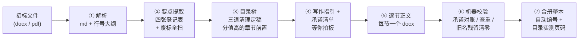
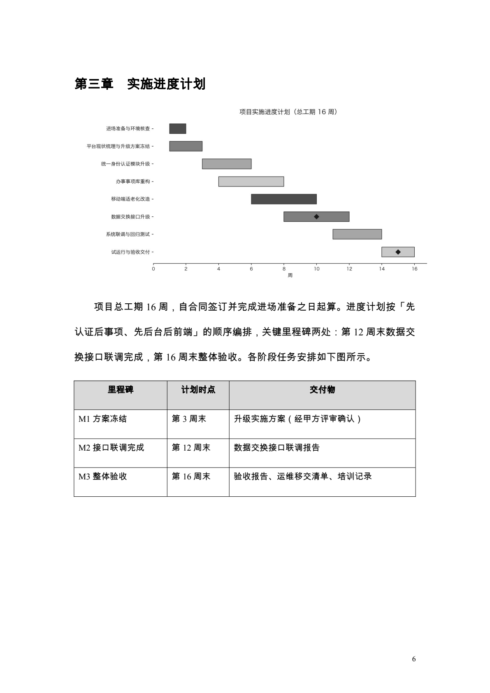

<div align="center">


# 灵燕标书写作套件 Full-Pipeline Bid Writing Suite

**一个专门编写投标文件（标书）的 AI Agent Skill。**
**已在多份真实标书的完整编写中实战使用——每个版本都由真实项目复盘打磨而来。**

[](LICENSE)
[](listing/CHANGELOG.md)


*An agent skill that turns a tender document into a submission-ready Word proposal —
parse → register → outline → write → validate → assemble.*

</div>

---

## 这是什么

**这不是「通用文档写作工具」，它只做一件事：把招标文件变成可以递交的标书 Word。**

把本技能装进 Claude Code / CodeBuddy / WorkBuddy 等支持 Agent Skill 的环境，丢给它一份
招标文件（docx / pdf），它会走完一条带质量闸门的流水线：解析 → 要点登记 → 目录规划 →
承诺拍板 → 逐节写作 → 机器校验 → 合册出书，最终交付每册一本**可直接递交的整本 docx**。

**实战背书**：本技能已在多份真实标书编写中从头跑到尾。[CHANGELOG](listing/CHANGELOG.md)
里 1.0 → 1.1.3 的每一次迭代都来自真实投标项目的复盘修复——真机首测修出的 5 个 P0、
真实项目节间查重误报从 24 条收敛到 1 条、按真实评分表对齐目录先后……方法论不是纸面推演，
是被评委和甲方阅读习惯反复校准过的。

## 写标书的三类事故，与对应防线

任何一类都可能直接废标，所以这套技能的每个环节都在防它们：

| 常见事故 | 本套件的防线 |
|---|---|
| **编数字**：AI 编造工期、人员、报价 | 承诺类数字只出自你逐条拍板的《关键事实与承诺》清单，机器校验逐条对账——承诺了没写进正文会被点名，改了承诺旧值残留会被检出 |
| **丢要求**：漏掉废标条款 / 评分点 | 要点登记四张表（必须章节 MAND / 招标模板 TPL / 商务技术要求 REQ / 评分维度 SCORE）+ 废标条款全扫，目录与正文的每节都挂来源编号，覆盖情况逐条可审计 |
| **改了乱**：手改合册后章节编号全错 | 整本是派生产物——改内容回节文件层改再重新合册，章节编号由树位置纯函数生成，永不手写 |

## 工作流程



每个环节的详细纪律在 [`tender-writing-suite/references/`](tender-writing-suite/references/)，
共 9 份方法论文档，Agent 按需读取。

## 产出长什么样

下面整本 docx 由本技能全流程自动产出（为演示使用虚构主体「云澜市 / 星灵创科」，
版式即真实交付版式——宋体小四正文、黑体标题族、表头跨页重复）：

| 封面（机械生成） | 目录（条目写实测页码） |
|:---:|:---:|
|  |  |
| **逐条响应表（来源可追溯）** | **甘特图（真图 PNG，非占位）** |
|  |  |
| **分层架构图（真图 PNG）** | **团队配置表** |
|  |  |

此外还有：表格引擎支持合并单元格（横跨/竖并）、相对列宽、宽表横向页、行不跨页拆断；
历史标书素材元素级保真拷贝；目录页码可导出「标题→页码」映射（评分索引表回填用）。
收尾会给出沉淀建议：成品标书与公司事实归入你的资料库/知识库后，下次自动成为
可检索素材——越用越快。

## 快速开始

**1. 安装依赖**（一次性）

```bash
pip install python-docx pypdfium2 docxcompose Pillow
```

**2. 装进你的 Agent 环境**

把 [`tender-writing-suite/`](tender-writing-suite/) 整个目录放进所用 Agent 的技能目录
（Claude Code / CodeBuddy / WorkBuddy 等支持 Agent Skill 规范的环境均可）。

**3. 说一句话开始**

```text
解读这份招标文件，提取要点并生成投标目录树
梳理废标条款和评分标准，帮我整理成登记表
按目录写第 3 章，写法参考我上传的历史标书
```

## 技能包结构

```text
tender-writing-suite/
├── SKILL.md              # 技能入口：双语元数据 + 全流程编排纪律
├── references/           # 9 份方法论（解析 / 要点 / 目录 / 证据 / 正文 / 版式……）
├── scripts/
│   ├── parse_document.py # 解析：md + outline.json + meta.json（docx 另有元素映射，供保真拷贝）
│   ├── docx_toolkit.py   # docx 全生命周期：create / revise / comment / image / diagram
│   │                     #   / render-page / copy-from / assemble / toc-pages
│   ├── check_writing.py  # 机器校验：指引 / 单节 / 全局承诺比对 + 查重 + 残留扫描
│   └── make_template.py  # 基准版式模板生成器
└── templates/            # 基准版式模板 + 示例产物（目录树 / 写作指引 / 承诺清单）
```

## 设计原则

- **语义归模型，机械归程序**：解析、表格引擎、章节编号、目录页码、对账校验全部是
  确定性 Python 脚本；模型只做理解、组织与写作，每一步都有程序兜底。
- **纯本地运行**：三个脚本零网络请求，招标文件与公司素材不出本机。
- **正文干净**：占位与待办一律走 Word 批注，交付稿里没有任何占位文字（机器扫描兜底）。
- **能力边界如实说明**：扫描件（图片型 PDF）与 `.doc` 不支持；甘特图 / 架构图出真图
  需要 `matplotlib` 与中文字体（缺失时自动回落表格表达）；公司事实与素材来自你的
  知识库 / 上传文件，不联网检索。

## 维护者

- 改动技能包后跑自检：`python3 listing/self_check.py`
  （frontmatter / YAML 语法 / 字数 / 沿革从句门）
- 版本号在 `SKILL.md` frontmatter 的 `version` 手工递增，并在
  [`listing/CHANGELOG.md`](listing/CHANGELOG.md) 追加一行版本史。

## License

[MIT](LICENSE) © 2026 LingYan (灵燕智能) —— 方法论、脚本与模板均可自由使用与二次开发。

> 本仓库示例中的「云澜市 / 星灵创科 / YLCG-2026-GK-0387」均为演示用虚构主体，
> 如与真实机构、项目编号雷同纯属巧合。
